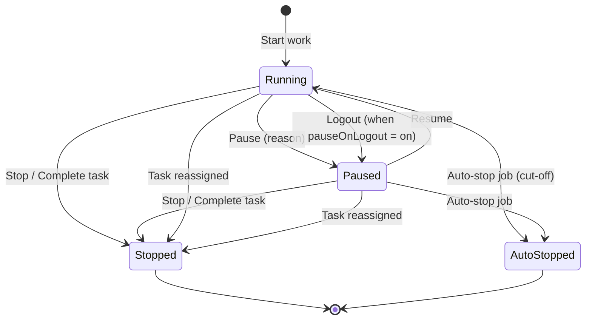

# 04 — Detailed Specifications

Contents: §1 Notification event matrix · §2 Calendar integration · §3 Task timer calculation logic · §4 Dashboard widgets · §5 UI/UX screens and navigation · §6 Reporting

---

## 1. Notification event matrix

**Default channel order:** WhatsApp → (SMS fallback) → in-app. In-app is always written. E-mail is used where marked.
**Mandatory** = the employee cannot switch it off (they can only change the channel). It always reaches in-app at least.
**WA category** is the expected Meta template category. It affects price and opt-in rules, so confirm with the provider.

| ID | Event key | Trigger | Recipients | Channels (default) | Mandatory | Timing | Key variables | Dedupe key | WA category | Cancelled when (BR-N7) |
|---|---|---|---|---|---|---|---|---|---|---|
| N01 | `employee.welcome` | Employee becomes Active with a verified, opted-in phone (or at first verification) | Employee | WA→SMS, in-app | No | Immediate (quiet hours apply) | employee_name, company_name, branch_name | `welcome:{eid}` | Utility | Employee inactive |
| N02 | `attendance.reminder` | Scheduled: shift start − 10 min (configurable) on a working day | Employee not checked in, not on leave, not weekly off or branch holiday, not core team | WA, in-app | No | start − X | employee_name, shift_start, branch_name | `attrem:{eid}:{date}` | Utility | Punch recorded before send |
| N03 | `attendance.late` | (a) first punch is marked Late; (b) scheduled at start + grace + 15 min with no punch and no leave | Employee. Manager gets an **in-app digest** at 10:30 | WA→SMS, in-app | No | Immediate | employee_name, check_in_time, shift_start, branch_name | `late:{eid}:{date}` | Utility | (b) only: punch arrived |
| N04 | `leave.submitted` | New leave request (`Pending`) | Reporting manager + BA of the employee's branch (admins if no manager) | in-app, e-mail (existing switch), WA | No | Immediate | employee_name, leave_dates, leave_type | `leavesub:{leaveId}:{recipient}` | Utility | Leave cancelled |
| N05 | `leave.decided` | Pending → Approved or Rejected | Employee | WA→SMS, in-app, e-mail | **Yes** | Immediate | employee_name, leave_dates, **leave_status**, approver_name | `leavedec:{leaveId}:{status}` | Utility | — |
| N06 | `task.assigned` | Task created, or assignee changed (incl. action item → task) | New assignee | WA→SMS, in-app | No | Immediate. **Digest** if > 5 to one person within 10 min | employee_name, **task_name**, due_date, assigned_by, estimated_time | `taskasg:{taskId}:{eid}` | Utility | Task deleted or reassigned before send |
| N07 | `task.deadline_reminder` | Scheduled: due − 1 day at 10:00 and due day at 09:30 (branch time); also on becoming *at risk* | Assignee | WA, in-app | No | Scheduled | employee_name, task_name, due_date, remaining_time | `taskdue:{taskId}:{due}:{offset}` | Utility | Task done or due date moved |
| N08 | `task.completed` | Status → done | Creator (`createdBy`) and reporting manager (once if the same person) | in-app, WA | No | Immediate | employee_name, task_name, actual_time, estimated_time | `taskdone:{taskId}:{doneOn}:{recipient}` | Utility | Reopened before send |
| N09 | `task.time_exceeded` | Actual time crosses `overrunWarnPct` (warning) and 100 % (exceeded) | Assignee + creator/manager | in-app, WA | No | When the threshold is crossed (checked on each stop and every 5 min for running sessions) | employee_name, task_name, estimated_time, actual_time | `taskover:{taskId}:{80\|100}:{recipient}` | Utility | — |
| N10 | `meeting.invitation` | Meeting created, or participant added (not "record only") | Internal participants. External: e-mail + .ics only | WA→SMS, in-app, e-mail + .ics | No | Immediate | employee_name, **meeting_title, meeting_date, meeting_time**, meeting_location / meeting_link, organizer_name | `mtginv:{meetingId}:{participant}:{seq}` | Utility | Meeting cancelled |
| N11 | `meeting.reminder` | Scheduled at each reminder offset | Participants not declined | WA→SMS, in-app | No (offsets < 2 h ignore quiet hours) | start − offset | as N10 | `mtgrem:{meetingId}:{participant}:{offset}:{startUtc}` | Utility | Cancelled. A rescheduled meeting gets new keys (start is in the key) |
| N12 | `meeting.updated` | Material change (date, time, location, room, URL) | Participants. Removed participants get N13 | WA→SMS, in-app, e-mail + .ics | **Yes** | Immediate (several edits within 2 min are combined) | as N10 + old_time | `mtgupd:{meetingId}:{participant}:{seq}` | Utility | — |
| N13 | `meeting.cancelled` | Meeting or occurrence cancelled, or participant removed | Participants | WA→SMS, in-app, e-mail + .ics CANCEL | **Yes** | Immediate | meeting_title, meeting_date, meeting_time, reason | `mtgcan:{meetingId}:{participant}` | Utility | — |
| N14 | `employee.birthday` | Scheduled 09:00 branch time on date of birth | Employee (colleagues see it in the in-app feed, as today) | in-app. **WA off by default** | No | 09:00 | employee_name, company_name | `bday:{eid}:{year}` | **Marketing** (likely) | Inactive |
| N15 | `branch.announcement` | Notice published with "Also send via" | Notice audience | WA→SMS, in-app | No | Immediate or scheduled | employee_name, announcement_title, branch_name | `notice:{noticeId}:{eid}` | Marketing or Utility (depends on the template chosen) | Notice deleted before send |
| N16 | `time.manual_submitted` | Manual entry or adjustment submitted | Approvers | in-app (WA optional) | No | Immediate. Digest if > 3 per hour | employee_name, task_name, duration, reason | `tmsub:{entryId}:{approver}` | Utility | Withdrawn |
| N17 | `time.manual_decided` | Approved or rejected | Employee | in-app, WA | No | Immediate | employee_name, task_name, decision, comment | `tmdec:{entryId}` | Utility | — |
| N18 | `time.auto_stopped` | Auto-stop job | Employee | in-app, WA | No | Immediate (quiet hours → morning) | employee_name, task_name, stop_time | `tmauto:{sessionId}` | Utility | — |
| N19 | `employee.transferred` | Transfer takes effect | Employee; new BA (in-app) | WA, in-app | No | Effective date at 09:00 | employee_name, branch_name, effective_date | `xfer:{transferId}:{recipient}` | Utility | Transfer cancelled |
| N20 | `meeting.minutes_published` | Minutes published | Participants | in-app, e-mail | No | Immediate | meeting_title, organizer_name | `mins:{meetingId}:{version}:{participant}` | — | — |
| — | Manual / bulk campaign | HR/BA/SA send | Chosen audience | as chosen | — | Now or scheduled | template variables | `camp:{campaignId}:{eid}:{channel}` | per template | Campaign cancelled |

**Recipient resolution (in order):** event config on? → employee active? → preference for the event group on, or mandatory? → quiet hours (delay)? → for each channel in preference order: channel enabled for the company and event? approved template exists? phone verified and opted in? cap not exceeded? → create delivery. Every skipped channel is recorded with a reason code: `channel_off, no_template, not_verified, no_consent, opted_out, cap_reached, quiet_delayed`.

**Delivery state machine:**
`queued → sending → sent → delivered → read` · `sending → failed_temp → (retry) → sending` · `sending|sent → failed_perm` · `queued → cancelled` · `* → fallback_triggered` (linked SMS delivery created).

---

## 2. Calendar integration specification

### 2.1 Providers and permissions

| Provider | Scopes requested | Used for |
|---|---|---|
| Google Calendar | `openid email`, `https://www.googleapis.com/auth/calendar.events`, `https://www.googleapis.com/auth/calendar.freebusy` | Create, update and delete events for meetings the user organises. Free/busy for conflict checks |
| Microsoft Outlook (Graph) | `openid email offline_access User.Read Calendars.ReadWrite` | Same, plus `getSchedule` for free/busy |
| Internal calendar | — | Always on. The `Meeting` table is the **source of truth** |

### 2.2 Connection flow (per user, consent-based)
1. *My settings → Calendar → Connect Google / Outlook* shows a plain notice: what is written (meetings you organise), what is read (free/busy, and replies to your meetings), and how to disconnect.
2. The server creates a PKCE verifier and a signed `state` (tenant slug, user id, nonce, 10-minute expiry).
3. The provider's consent screen opens. Callback: **`https://<base-domain>/oauth/<provider>/callback`** (SaaS: one platform URL, because providers do not allow wildcard redirect URIs). The callback checks `state`, switches to the tenant DB, exchanges the code and stores **encrypted** tokens, then redirects to `https://<tenant>.<base>/#settings`.
4. Single-company edition: the callback is on its own host. It needs `HUB_GOOGLE_CLIENT_ID/SECRET` and/or `HUB_MS_CLIENT_ID/SECRET` and public HTTPS. Without them the `calsync` module is unavailable, and `.ics` e-mail invites still work.
5. **Disconnect** revokes the token at the provider and deletes the stored tokens. The user chooses: "Keep already-synced meetings in my calendar" (default) or "Remove them".
6. Admins **cannot** connect or read another user's calendar.

### 2.3 Sync model: one provider event per meeting, owned by the organizer
| Situation | Behaviour |
|---|---|
| Organizer **connected** | Create one event in the organizer's primary calendar, with all participants (internal work e-mails + externals) as attendees and `sendUpdates=all` (Google) / default invitations (Graph). **The provider sends the invites.** The system sends **no** `.ics` to those attendees (avoids duplicates) but still sends WhatsApp, SMS and in-app notices |
| Organizer **not connected** | The system e-mails a `.ics` (`METHOD:REQUEST`) to every participant with an e-mail address. Updates send the same `UID` with `SEQUENCE+1`. Cancellation sends `METHOD:CANCEL` |
| Participant connected, organizer not | The participant's calendar receives the `.ics` by e-mail like everyone else. The system does **not** also write into the participant's calendar (avoids duplicates) |
| Online meeting, platform = Google Meet, organizer on Google | Request `conferenceData`. The Meet link that comes back fills the URL field |
| Online meeting, platform = Teams, organizer on Microsoft | `isOnlineMeeting=true`. The Teams join URL fills the URL field |
| Recurring series | Each occurrence is synced as its own event (they are stored as individual meetings). Accepted trade-off: the provider does not show them as a series |

**Stable identity (duplicate prevention):**
- iCal UID = `mtg-<meeting-uuid>@<tenant-host>`.
- Google: the event `id` is a deterministic base32hex value derived from the meeting uuid, so a retried create returns 409 (already exists) instead of a duplicate.
- Graph: `transactionId` = meeting uuid (idempotent create).
- `CalendarEventLink` is unique on `(meeting, connection)`.

### 2.4 Field mapping
| Meeting | Google / Graph |
|---|---|
| title | summary / subject |
| start_at, end_at, tz | start/end `dateTime` + IANA `timeZone` |
| location | room name + branch address, or venue text, or "Online (platform)" |
| agenda + description | description/body: agenda items, description, "Join: <url>", "Open in Assertive Hub: <link>" |
| participants | attendees (email, displayName, optional flag) |
| visibility private | `visibility: private` / `sensitivity: private` |
| reminders | provider reminders **off** (the system sends its own). The user can change this in settings |
| cancelled | Google `events.delete` with `sendUpdates=all` / Graph `POST /events/{id}/cancel` |

### 2.5 Two-way behaviour (where the provider allows it)
| Direction | v6 | Mechanism |
|---|---|---|
| App → calendar: create, update, cancel | ✓ | Job `calsync.push` after commit |
| Calendar → app: **RSVP responses** | ✓ | Google `events.watch` push channel + incremental `syncToken`. Graph change notifications (subscriptions renewed by a job before expiry) + delta query. **Fallback:** poll linked upcoming events every 15 min when push cannot be registered (no public HTTPS) |
| Calendar → app: organizer edits time or title in Google/Outlook | **Detected and flagged** ("Changed in Google Calendar: 15:00 → 16:00. Apply / Keep app version"). Not applied automatically in v6 | Same feed. Phase 2 may apply automatically |
| Calendar → app: event deleted externally | Link marked `deleted_externally`. Organizer notified in-app. Not recreated | Same feed |
| Free/busy for conflict checks | ✓ | `freeBusy` / `getSchedule` for connected participants during the form session (5-minute cache). Only busy/free is shown, never details |

### 2.6 Error handling
| Error | Handling |
|---|---|
| `invalid_grant` / 401 after refresh (token revoked or expired) | Connection → `revoked`. In-app banner "Reconnect your calendar". Future meetings fall back to `.ics` e-mail |
| 403 insufficient scope | Connection → `needs_consent`. Prompt to reconnect |
| 404 on update (deleted externally) | Link → `deleted_externally`. Organizer notified. No recreate |
| 409 on create (already exists, from the deterministic id) | Treat as success. Fetch and store the provider id and etag |
| 412 etag mismatch | Refetch, then overwrite with the app version (app wins in v6), log a conflict note |
| 429 / 5xx / timeout | Retry at 1 min, 5 min, 30 min, 2 h, 6 h, 12 h (max 6), then link → `error`. Shown in System health and on the meeting ("Not synced, retrying") |
| Push channel or subscription expired | The renewal job runs daily. On failure it falls back to polling |

**Time zones:** meetings store UTC plus an IANA zone (organizer's branch). They are displayed in the viewer's zone. DST is handled by the provider and by Python `zoneinfo`.

---

## 3. Task timer calculation logic

### 3.1 State machine

*Closing the browser changes nothing (the session lives on the server). With `pauseOnLogout = off`, logout also changes nothing. Auto-stopped sessions stay flagged `needs_review` until the employee confirms them or submits an adjustment.*

**Allowed actions by state** (anything else returns `409 INVALID_STATE` with the current state):

| State | Start | Pause | Resume | Stop | Complete | Manual entry |
|---|---|---|---|---|---|---|
| none (no open session on this task) | ✓ | — | — | — | ✓ (no session) | ✓ |
| Running | — | ✓ | — | ✓ | ✓ | ✓ (for another time range) |
| Paused | — | — | ✓ | ✓ | ✓ | ✓ |

### 3.2 Storage approach (O(1) reads, auditable)
Each session holds running totals that are updated **at each transition**, inside one transaction:
```
on transition at server time t:
    elapsed = t - session.last_transition_at
    if session.status == RUNNING: session.work_seconds  += elapsed
    if session.status == PAUSED:  session.pause_seconds += elapsed
    session.last_transition_at = t
    session.status = <new state>
    if new state in (STOPPED, AUTO_STOPPED): session.ended_at = t
    insert WorkSessionEvent(type, at=t, actor, reason, note, req_id, client_ts)
```
Live value for display: `work = work_seconds + (now - last_transition_at if RUNNING else 0)`.
The event log is the audit trail. A nightly integrity job recalculates totals from the events and flags any mismatch.

**Auto-stop** uses the cut-off time `c`, not the job's run time: `elapsed = c - last_transition_at`, `ended_at = c` (BR-T14).

### 3.3 Concurrency and integrity
- Each action runs in one DB transaction. A partial unique index prevents more than one running session per employee (default policy) and more than one open session per (employee, task).
- Each action carries a client `reqId` (UUID). `(session, req_id)` is unique, so a replayed request returns the original result (double-tap, flaky mobile network).
- The client shows time using `serverOffset = response.now − Date.now()`. The device clock is never trusted.
- Two tabs or two devices: each action response returns the authoritative state. The timer bar polls `time.state` every 60 s and on window focus.

### 3.4 Formulas (all computed in **seconds**, displayed as `Hh Mm`)
| Measure | Formula | When undefined |
|---|---|---|
| Estimated **E** | `task.est` (minutes × 60) | No estimate → "—" |
| Actual **A** | Σ approved timer work seconds + Σ approved manual entries + Σ approved adjustment deltas | 0 when no time |
| Pending **P** | Σ manual entries and adjustments awaiting approval (shown separately, **not** in A) | — |
| Remaining | `max(E − A, 0)`. When `A > E` show "Over by `A − E`" | No E → "—" |
| Variance **V** | `A − E` (signed: negative = under estimate, positive = over) | No E → "—" |
| Variance % | `V / E × 100`, 1 decimal | No E → "—" |
| Efficiency | `E / A × 100`, 1 decimal | `A = 0` or no E → "—" |
| Aggregate efficiency (reports) | `ΣE / ΣA × 100` over **completed** tasks that have both E and A (time-weighted, not an average of ratios) | No qualifying tasks → "—" |

**Display rounding:** totals are kept to the second. Displayed minutes round half-up (≥ 30 s rounds up). Report sums are computed before rounding.

### 3.5 Worked examples (these double as test oracles)
| # | Input | Expected |
|---|---|---|
| X1 (from the brief) | E = 5 h. Sessions 1 h 30 m, 2 h, 1 h | A = **4 h 30 m**; Remaining 30 m; V = **−30 m** (−10.0 %); Efficiency = 300 / 270 × 100 = **111.1 %** |
| X2 pause | Start 10:00, pause 10:45, resume 11:00, stop 12:00 | Session work **1 h 45 m**, pause **15 m**, elapsed 2 h |
| X3 over | E = 2 h, A = 2 h 30 m | Remaining 0, "Over by 30 m"; V = +30 m (+25.0 %); Efficiency **80.0 %**; N09 sent at 1 h 36 m (80 %) and at 2 h (100 %) |
| X4 pending manual | E = 3 h. Timer 2 h. Manual entry 45 m pending | A = **2 h**, P = 45 m, Efficiency 150.0 %. After approval A = 2 h 45 m, Efficiency 109.1 % |
| X5 rejected manual | As X4, rejected | A stays 2 h. Entry kept as `rejected` with the comment |
| X6 auto-stop | Branch day end 18:30, grace 120 min. Started 17:00, still running at 21:00 | Job sets ended_at **20:30**. Work 3 h 30 m, `needs_review`, N18 |
| X7 midnight split (night-shift policy, 23:59 cut-off off) | 23:30 → 00:45 | Day 1: 30 m, day 2: 45 m in daily reports. Session total 1 h 15 m |
| X8 no estimate | E none, A 1 h | Remaining, V and Efficiency show "—". The task counts in the "No estimate" bucket |
| X9 aggregate | Task A: E 5 h, A 4 h 30 m. Task B: E 2 h, A 2 h 30 m | ΣE 7 h / ΣA 7 h = **100.0 %** (not the average of 111.1 and 80 = 95.6) |
| X10 switch | Running on T1 since 10:00. At 11:00 Start on T2 with switch | T1 session stopped at 11:00 (1 h). T2 session starts at 11:00. One transaction |

### 3.6 Attribution for reports
- **Day:** split each work interval at branch-local midnight. Pause intervals are excluded.
- **Branch / department:** the snapshot on the session (assignee's branch and department at session start). Manual entries take the snapshot at their date.
- **Employee:** the person who logged the time, even after the task is reassigned.

---

## 4. Dashboard widget specifications

General rules: widgets reuse the existing `panel` style. Each widget fetches its own endpoint (never `load`), refreshes on focus and at most every 60 s, and shows a skeleton while loading, an empty state, and an error state with a *Retry* button. Data is always scoped on the server. Widgets the user's capabilities do not cover are not rendered and not fetched.

| ID | Widget | Visible to | Endpoint | Contents | Actions |
|---|---|---|---|---|---|
| **W1** | **Meeting Schedule** (dedicated) | Everyone (when the meetings module is on) | `meetings.widget` | **Tabs:** Today · Upcoming (7 days) · Completed (7 days back) · Cancelled (7 days back) · **Calendar** (week strip with day dots, switchable to month). **Item:** start time, duration, category pill (colour per category), title, location (room/venue) or platform icon, participant avatars (up to 4 + "+n"), my RSVP, status. **Next-up banner:** "Sprint sync starts in 12 min · Join". **Reminders:** a bell icon shows the reminders set for the item | Join (from 10 min before), RSVP (Accept/Decline), open detail, **Quick create** (opens the form pre-filled with the next free 30-minute slot), View all |
| | Filters | Shown by capability | | **Date** (everyone), **Category** (everyone), **Employee** (MG+ within scope), **Department** (BA/HR/BM/CA/SA), **Branch** (multi-branch users only) | Filters remembered per device |
| W2 | Today strip in the greeting card | Everyone | from W1 data | Adds "3 meetings today · next at 3:00 PM" to the existing day summary | Click → W1 Today |
| W3 | Task overview | Everyone | `tasks.overview` | To do / In progress / Done (period), Overdue, **At risk**, my running timer. Managers also see a per-person breakdown (top 5 by open load) | Open filtered task board |
| W4 | Work-time summary | Everyone (self); MG+ (team) | `time.summary` | **Task time** today and this week vs **Attendance hours** (two labelled bars, BR-T10). Estimated vs actual for tasks completed this week. Approvers see pending manual entries | Open Work logs / Approvals |
| W5 | Branch overview | SA, CA, HR (multi-branch) | `branches.overview` | Per branch: headcount, present today %, late, on leave, open tasks, meetings today, notification failures (24 h) | Click branch → dashboard filtered to it |
| W6 | Notifications and reminders | Everyone | `notify.inbox` + existing computed list | Unread in-app notifications (latest 5) merged with the existing "needs you" items, plus my upcoming reminders (meetings, task due) | Mark read, open target |
| W7 | Workload (next 5 days) | MG, BM, BA, HR, CA, SA | `time.workload` | Capacity vs planned per person (bar). Red when > 100 % | Open person's tasks |
| — | Existing widgets | unchanged | `load` | Needs you, today's attendance, gauge, trend, work completed, on-time, top performers, team pulse, out today | unchanged |

**Configurable layout:** "Customise dashboard" opens a list of widgets with show/hide switches and ▲/▼ buttons (no drag-and-drop library is added). It is saved in `Profile.prefs.dash = {order:[...], hidden:[...]}`. The SA can set **default layouts per role** (Settings → Dashboard) and users can reset to the default. The existing period and department filters, plus a new **branch filter** for multi-branch users, apply to all compatible widgets.

---

## 5. UI/UX screen requirements and navigation

### 5.1 Navigation (recommended structure mapped onto the existing shell)
The existing sidebar has groups (Workspace / Insights / Manage), a mobile bottom bar and a "More" sheet. To keep the UX consistent, top-level items stay as nav items and **sub-pages become tabs at the top of the page** (like the existing Settings sections). The nav does not get nested menus.

| Recommended nav | Implementation | Existing page reused |
|---|---|---|
| 1 Dashboard | Unchanged + new widgets | `dashboard` |
| 2 Employee Management | "Employees" page + new tabs: *Directory · Departments & designations · Transfers* | `employees` |
| 3 Branch Management | **New** page `branches` (SA, CA, HR, BA): *Branches · Rooms · Branch admins* | — |
| 4 Attendance & Leave | Existing `attendance` and `leave` pages stay separate in the nav (high-traffic). Both gain a branch filter | `attendance`, `leave` |
| 5 Task Management | "Tasks" page with tabs: *My tasks · Assigned tasks · Time tracker · Work logs · Task reports* | `tasks` |
| 6 Meeting Management | **New** page `meetings`: *My meetings · All meetings · Calendar · Minutes · Reports* | — |
| 7 Communication & Notifications | **New** page `comms` (SA, CA, HR, BA): *Send · Scheduled · History · Templates · Events · WhatsApp · SMS* | Notice board stays separate and gains "Also send via" |
| 8 Reports & Analytics | **New** hub `reports` that links to the existing Work report, Monthly review and Performance, plus the v6 reports | `workrep`, `review`, `performance` |
| 9 Settings & Permissions | Existing Settings accordion gains sections: *Branches & time zones · Time-tracking policy · Notifications (company) · Calendar (my connection) · Dashboard defaults · Roles & permissions (read-only matrix) · System health*. **Users** stays in the Manage group | `settings`, `users` |

Mobile bottom bar (Home, People, Attendance, Tasks, Clients, More): **unchanged**. *Meetings* goes in "More" and in the W1 widget. The **timer bar** sits above the bottom bar.

### 5.2 Screen catalogue
| ID | Screen | Roles | Key elements | States and validation |
|---|---|---|---|---|
| S-01 | Branch list | SA, CA, HR, BA | Cards/table: code, name, city, manager, headcount, status. Search, "Show inactive", Add (SA) | Empty: "Your company has one branch (Head Office). Add a branch to start." |
| S-02 | Branch form | SA | All branch fields; working hours (start, end, break, days); time zone (searchable, default Asia/Kolkata); HO flag | Inline validation per BR-B3/B4. Code locked after first use (tooltip says why) |
| S-03 | Branch detail | SA, CA, HR(B), BA(B), BM(B) | Tabs: Overview (KPIs) · Employees · Departments · Rooms · Admins & manager · History | Deactivate button shows blockers (BR-B5) |
| S-04 | Transfer form (modal) | SA, CA, HR | Employee, to-branch, effective date, department, designation, manager, reason; side-effects checklist (FR-BR-09) | Date rules (FR-BR-07); overlap → error |
| S-05 | Profile → *Branch history* tab | per scope | Timeline (branch, dept, designation, manager, from–to, by, reason); cancel scheduled transfer | — |
| S-06 | Departments & designations | SA, CA (edit), others view | Two lists, merge duplicates, map departments to branches, department head | Rename cascades (confirmation shows the number of employees affected) |
| S-07 | WhatsApp / SMS configuration | SA | Provider, credentials (masked, "Replace"), sender (phone number id / DLT header), entity id, webhook URL + verify token (copy buttons), **Test connection**, enable switch | Errors from the provider shown verbatim with a hint |
| S-08 | Templates | SA, CA (edit); HR, BA view | List grouped by event with channel and language chips and approval status; editor with variable chips, live preview, character counter, DLT id field, Submit / Sync status | Unknown variable → error; WA body > 1024 characters → error |
| S-09 | Event configuration | SA, CA | Table of N01–N20: enabled, channels, fallback, timing offsets, quiet-hours behaviour; branch override drawer | — |
| S-10 | Send message | SA, CA, HR, BA, BM (announcements) | Audience builder (individuals / department / branch / designation) → recipient preview ("142 recipients · 9 will be skipped: 5 no consent, 3 no number, 1 opted out"), template, variables, channel, now or schedule, cost estimate | Second confirmation over 200 recipients |
| S-11 | Scheduled sends | same | List, edit, cancel | Locked within 1 min of send |
| S-12 | Notification history | SA, CA, HR(B), BA(B) | Filters, table (time, recipient, event, channel, status pill, attempts), detail drawer (rendered text, timeline, fallback chain, provider id, error), Retry, Export | — |
| S-13 | My notifications (Settings → Personal) | Everyone | Phone + Verify (OTP), WhatsApp/SMS opt-in switches with notice text, per-group switches, channel order, quiet hours, language, my inbox | Mandatory events show a lock icon and an explanation |
| S-14 | My meetings | Everyone | List grouped by day; tabs Upcoming / Past / Cancelled; RSVP inline | — |
| S-15 | All meetings | MG+ | Same + filters (branch, department, employee, category, status, organizer) | — |
| S-16 | Meeting calendar | Everyone | Day / week / month; colour by category; leave and holiday overlays; click empty slot → create | — |
| S-17 | Meeting form | Everyone | See §5.3; live conflict panel; availability badges in the participant picker | Per BR-M1..M5 |
| S-18 | Meeting detail | Participants + scope | Header (time, status, Join), RSVP, participants with RSVP and attendance, agenda, attachments, sync status, tabs *Minutes · Action items · History* | Organizer actions: Edit, Cancel (reason), Mark completed, Mark attendance |
| S-19 | Minutes editor | Organizer (+ SA/CA/BA) | Summary, discussion list, decisions list, action items grid (title, assignee, due, priority, estimate, "Create task"), follow-up date, Save draft / Publish | Lock after 7 days |
| S-20 | Rooms | SA, CA, BA, BM | Per branch: name, capacity, facilities, status; day timeline of bookings | — |
| S-21 | Tasks (tabs) | Everyone | *My tasks* (board, current) · *Assigned tasks* (tasks I created or manage) · *Time tracker* (my open sessions + today's log) · *Work logs* (sessions table) · *Task reports* | — |
| S-22 | Task form (enhanced) | MG+ | Existing fields + estimate, per-day hours, start date, department, branch, attachments, tracking toggles | est ≥ 5 min; start ≤ due; per-day ≤ branch day length |
| S-23 | Task card and detail | Everyone | Card: estimate vs actual mini bar, ▶/⏸ button, at-risk badge. Detail: time panel (E, A, P, Remaining, Variance, Efficiency) and session list | — |
| S-24 | Timer bar | Assignee | Task title, live h:mm:ss, state, Pause (reason menu), Resume, Stop (remarks), Complete; "Needs review" chip for auto-stopped sessions | `aria-live="polite"` |
| S-25 | Manual entry / adjustment (modal) | Assignee | Date, start/end or duration, reason, category | Rules FR-TIME-12 |
| S-26 | Time approvals | Approvers | Queue with filters; approve or reject (comment); bulk approve | — |
| S-27 | Time-tracking policy | SA, CA, BA (override) | Fields of FR-TIME-17 with plain descriptions | — |
| S-28 | Reports hub | per role | Cards per report (§6) | — |
| S-29 | Customise dashboard | Everyone | §4 | — |
| S-30 | Calendar connections (Settings) | Everyone | Connect / disconnect Google, Outlook; status; last sync; errors | — |
| S-31 | System health | SA | Queue depth, failed jobs, provider status, webhook last received, calendar errors | — |

### 5.3 Meeting form: field specification
| Field | Type | Required | Shown when | Rules / default |
|---|---|---|---|---|
| Title | text | ✓ | always | 3–150 characters |
| Category | select (10) | ✓ | always | Sets defaults (location type, visibility) |
| Custom type | text | ✓ when Other | Category = Other | 2–50 characters |
| Date | date | ✓ | always | ≥ today (unless Record only) |
| Start time / End time | time | ✓ | always | 5-minute steps; end > start |
| Duration | h:mm | auto | always | Two-way with end time; 5 min–12 h |
| Time zone | display / select | auto | multi-tz companies only | Organizer's branch zone |
| Organizer | employee | ✓ | always | Defaults to self; MG+ may organise on behalf of someone in scope |
| Participants | multi-picker | ✓ (≥ 1 other) | always | Availability badges; max 200 |
| Branch | select | ✓ | multi-branch | Organizer's branch |
| Department / team | multi-select | ✓ for Team | Team (optional otherwise) | Adds members (removable) |
| Location type | select | ✓ | always | Online / In office / External venue / Hybrid |
| Physical location | text | ✓ for External venue | External venue, Hybrid | ≤ 200 characters |
| Office / meeting room | select | — | In office, Hybrid | Rooms of the branch; booked rooms disabled |
| Online platform | select | ✓ for Online | Online, Hybrid | Google Meet, Microsoft Teams, Zoom, Webex, Other |
| Meeting URL | url | ✓ for Online (unless auto-generate) | Online, Hybrid | https only; "Generate link" when the calendar supports it |
| Client name / company / location | picker + text | ✓ name for Client | Client | Picker lists the Clients module; free text allowed |
| External participants | repeater | — | Client, Vendor, Interview, Other | Name ✓, e-mail ✓, phone, company |
| Candidate | picker | — | Interview (if Recruitment is on) | — |
| Agenda | ordered items | — | always | ≤ 30 items |
| Description | textarea | — | always | ≤ 5,000 characters |
| Attachments | files | — | always | FR-PLT-07 |
| Reminders | offset chips | — | always | Defaults from settings; ≤ 3 |
| Recurrence | builder | — | always | FR-MTG-09 |
| Visibility | toggle | — | always | Private by default for One-to-One and Interview |
| Record only | checkbox | — | start in the past | Skips invites and sync |

---

## 6. Reporting requirements

**Common to all v6 reports:** server-side query, scoped to the viewer. Filters: date range (presets Today, This week, Last week, This month, Last month, Custom ≤ 366 days), branch, department, employee, task category, status. Sort on any column. Paged (50). **CSV export** of the full filtered set, streamed, with the same formula-injection protection as existing CSVs (prefix `'` on `= + - @` and tabs). Print view. Totals row. Branch attribution per BR-B7, day attribution per §3.6. Every report states "Task time is separate from attendance hours" where both appear.

| ID | Report | Audience | Grain | Columns | Chart |
|---|---|---|---|---|---|
| R-01 | Employee-wise work time | MG+ | Employee × period | Employee, branch, department, tasks worked, sessions, task time, manual (approved), pending, attendance hours (separate), task time / attendance hours % | Bar |
| R-02 | Task-wise work time | MG+ | Task | Task, assignee, category, status, E, A, P, V, V %, efficiency, sessions, first start, last stop | — |
| R-03 | Department-wise work time | BA/HR+ | Department × period | Headcount, task time, avg per head, E vs A for completed tasks, efficiency | Bar |
| R-04 | Branch-wise work time | HR/CA/SA | Branch × period | As R-03 by branch | Bar |
| R-05/06/07 | Daily / Weekly / Monthly work time | MG+ (EM: self) | Day, ISO week or month × employee | Task time per bucket; heat-map table | Line |
| R-08 | Estimated vs actual | MG+ | Task (completed in range) | E, A, V, V %, efficiency; summary: ΣE, ΣA, aggregate efficiency, % within ±10 % | Scatter (E vs A) |
| R-09 | Overdue tasks | MG+ | Task | Task, assignee, due, days overdue, status, E, A, remaining | — |
| R-10 | Tasks exceeding estimate | MG+ | Task | Task, assignee, E, A, over by, over %, status | Bar |
| R-11 | Manual time adjustments | MG+ (approvers) | Entry | Employee, task, date, duration, reason, category, status, approver, decided at, comment | — |
| R-12 | **Branch comparison** (consolidated) | SA, CA, HR(B) | Branch × period | Headcount (start/end), attendance %, late %, leave days, tasks completed, on-time %, aggregate efficiency, meetings held, meeting hours, minutes-recorded %, notification delivery % | Grouped bar |
| R-13 | Meeting summary | MG+ | Meeting | Date, category, organizer, branch, duration, participants, attendance %, minutes (Y/N), action items (open/done) | — |
| R-14 | Meeting attendance | MG+ | Employee | Invited, accepted, declined, attended, absent, attendance % | — |
| R-15 | Action items | MG+ | Item | Meeting, item, assignee, due, task status, overdue | — |
| R-16 | Notification delivery | SA, CA, HR(B), BA(B) | Event × channel | Sent, delivered, read, failed, fallback used, skipped by reason, cost (if the provider returns it) | Stacked bar |
| R-17 | Transfer history | SA, CA, HR | Transfer | Employee, from, to, effective, department/designation changes, by, reason | — |
| R-18 | Interruption reasons | MG+ | Reason × employee | Pause count, pause time, % of session time | Bar |
| R-19 | Workload | MG+ | Employee × day (next 10 days) | Capacity, planned, % | Bar |
| R-20 | Employee work summary (profile tab) | Self, MG+ | Week | Tasks done, task time, E vs A, meetings attended, action items | — |
