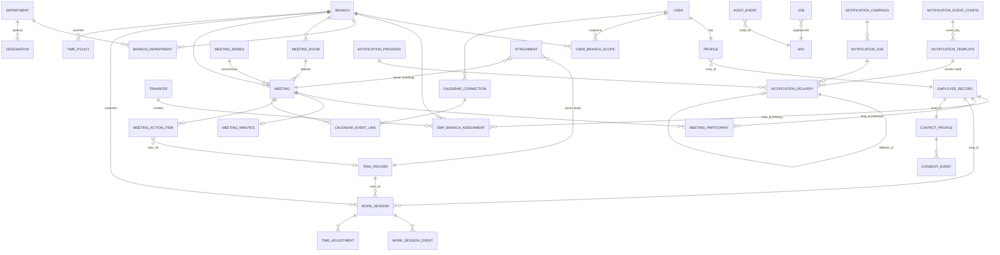

# 06 — Database Changes and ER Diagram

## 1. Design principles
1. **Existing tables are not restructured.** `Record`, `Attendance`, `Config`, `Profile` and `LoginFail` keep their schema. Existing collections get **additive JSON fields** only.
2. **v6 entities are relational Django models in the `core` app** (decision D1). They need constraints (one running timer, no room double-booking, no duplicate deliveries), indexed range queries (meetings by time, sessions by day) and SQL aggregation for reports. They are **not** part of the `load` blob or the snapshot-diff sync.
3. References to existing JSON entities use the **string record id** (`emp_id`, `task_rid`, `client_rid`, `candidate_rid`), because employees and tasks are `Record` rows. Integrity is enforced in the service layer. Indexes are added on these columns.
4. All timestamps are `DateTimeField` (UTC, `USE_TZ=True` is already on). Local dates for attribution are stored as `DateField` alongside where needed.
5. All tables live in the **tenant DB** (SaaS router default). OAuth state for the platform callback is the only exception: it lives in the platform DB (`saas` app).
6. Soft delete (`status`/`deleted_at`) for business entities. Logs are append-only.

## 2. ER diagram

## 3. New tables (Django models, `core` app)

Type shorthand: `str(n)` = `CharField(max_length=n)`, `txt` = `TextField`, `json` = `JSONField`, `dt` = `DateTimeField`, `date` = `DateField`, `int` = `IntegerField`, `bool` = `BooleanField`, `FK` = `ForeignKey(on_delete=PROTECT)` unless stated.

### 3.1 Branches and organisation
**`Branch`**
| Field | Type | Notes |
|---|---|---|
| id | BigAuto | |
| code | str(10) **unique** | BR-B3. Immutable once referenced |
| name | str(80) | Unique among active branches (service-level check) |
| address1, address2 | str(120) | |
| city, state | str(60) | `state` is used later for payroll PT (v6.1) |
| country | str(2) | ISO-3166 alpha-2, default `IN` |
| postal_code | str(10) | |
| phone | str(20) | E.164 |
| email | str(120) | |
| manager_emp | str(60) null, indexed | Employee record id |
| timezone | str(40) | IANA, default `Asia/Kolkata` |
| work_start, work_end | `TimeField` | |
| break_min | int | |
| work_days | json | e.g. `[1,2,3,4,5,6]` (JS weekday numbers, same convention as `settings.workDays`) |
| is_head_office | bool | Exactly one true (service + check on save) |
| status | str(10) | `active`, `inactive` |
| deactivated_at / _by / _reason | dt / FK User / str(300) | |
| created_at/_by, updated_at/_by | | |
Indexes: `(status)`, `(code)`.

**`UserBranchScope`**: user FK(CASCADE), branch FK, created_at/_by. **Unique (user, branch).**

**`EmployeeBranchAssignment`** (the history: source of truth for "branch on date")
| Field | Type | Notes |
|---|---|---|
| emp_id | str(60), indexed | |
| branch | FK Branch | |
| kind | str(10) | `primary`, `secondary` |
| effective_from | date | |
| effective_to | date null | null = open-ended |
| dept, designation | str(80) | Snapshot for the period |
| reports_to | str(60) | Snapshot |
| reason | str(300) | |
| transfer | FK Transfer null | |
| status | str(10) | `active`, `scheduled`, `ended`, `cancelled` |
| created_at/_by | | |
Constraints: a **partial unique index on `(emp_id)` WHERE `kind='primary' AND status='active' AND effective_to IS NULL`** guarantees at most one open primary assignment. Full non-overlap and no-gap checking across scheduled and back-dated rows (BR-B2) is done in the assignment service inside the same transaction. Index `(emp_id, kind, effective_from)`, `(branch, kind, effective_from)`.

**`Transfer`**: emp_id, from_branch FK, to_branch FK, effective_date, new_dept, new_designation, new_reports_to, reason, notes, status (`scheduled`, `applied`, `cancelled`), side_effects json (what was chosen: task reassignments etc.), created_at/_by, applied_at, cancelled_at/_by. Index `(emp_id, status)`, `(effective_date, status)`.

**`Department`**: name str(80) **unique**, code str(10) null unique, status. **`BranchDepartment`**: branch FK, department FK, head_emp str(60) null. **Unique (branch, department).** **`Designation`**: name str(80) **unique**, department FK null, status.

**`MeetingRoom`**: branch FK, name str(60), capacity int, facilities json (`["TV","VC","Whiteboard"]`), status. **Unique (branch, name).**

### 3.2 Meetings
**`MeetingSeries`**: rule json (`{freq: daily|weekly|monthly, interval, byweekday:[..], bymonthday, bysetpos, until, count}`), timezone, created_at/_by.

**`Meeting`**
| Field | Type | Notes |
|---|---|---|
| id | BigAuto | |
| uid | `UUIDField` unique | iCal UID base, provider idempotency |
| series | FK MeetingSeries null (SET_NULL) | |
| occurrence_date | date null | Original date within the series (for "this occurrence" edits) |
| title | str(150) | |
| category | str(20) | `online, direct, client, team, management, one_to_one, interview, training, vendor, other` |
| custom_type | str(50) | When `other` |
| status | str(12) | `scheduled, completed, cancelled` (`in_progress` is derived) |
| start_at, end_at | dt | UTC |
| timezone | str(40) | |
| organizer_emp | str(60) indexed | |
| organizer_user | FK User null | |
| branch | FK Branch | |
| departments | json | Names or ids used for Team meetings |
| location_type | str(10) | `online, office, external, hybrid` |
| room | FK MeetingRoom null | |
| location_text | str(200) | |
| platform | str(20) | `google_meet, teams, zoom, webex, other` |
| join_url | str(500) | https only |
| client_rid | str(60) null | Link to the Clients module |
| client_name, client_company, client_location | str(120) | |
| candidate_rid | str(60) null | Link to Recruitment |
| agenda | json | `[{title, presenter_emp, minutes}]` |
| description | txt | ≤ 5,000 characters |
| visibility | str(8) | `normal, private` |
| reminder_offsets | json | Minutes, e.g. `[1440, 15]` |
| record_only | bool | |
| sequence | int | iCal SEQUENCE, incremented on material change |
| cancelled_at/_by/_reason | | |
| completed_at/_by | | |
| created_at/_by, updated_at/_by | | |
Indexes: `(branch, start_at)`, `(organizer_emp, start_at)`, `(status, start_at)`, `(room, start_at)`, `(series)`.
Room overlap (BR-M3) is enforced in the service inside the transaction (SQLite has no exclusion constraints). The query is indexed on `(room, start_at)`.

**`MeetingParticipant`**
| Field | Type | Notes |
|---|---|---|
| meeting | FK(CASCADE) | |
| emp_id | str(60) null, indexed | Internal |
| ext_name, ext_email, ext_phone, ext_company | | External |
| role | str(10) | `organizer, required, optional` |
| rsvp | str(10) | `pending, accepted, declined, tentative` |
| rsvp_at, rsvp_note | dt, str(300) | |
| attendance | str(8) | `unknown, present, late, absent` |
| added_at/_by | | |
Constraints: **unique (meeting, emp_id)** (condition emp_id not null) and **unique (meeting, ext_email)** (condition ext_email ≠ ''). Index `(emp_id, meeting)`.

**`MeetingMinutes`**: meeting O2O(CASCADE), summary txt, discussion json `[str]`, decisions json `[str]`, follow_up_date date null, status (`draft, published`), published_at, version int, updated_at/_by, locked_at.

**`MeetingActionItem`**: meeting FK(CASCADE), title str(150), assignee_emp str(60), due_date, priority (`high, med, low`, same keys as tasks), est_min int null, task_rid str(60) null **unique** (one task per item), created_at/_by. Its status is read from the linked task.

### 3.3 Time tracking
**`WorkSession`**
| Field | Type | Notes |
|---|---|---|
| id | BigAuto | |
| task_rid | str(60) indexed | |
| emp_id | str(60) indexed | |
| user | FK User | Actor at start |
| branch | FK Branch | Snapshot at start (BR-B7) |
| dept | str(80) | Snapshot |
| kind | str(8) | `timer, manual` |
| status | str(12) | `running, paused, stopped, auto_stopped, void` |
| started_at | dt | Server time |
| ended_at | dt null | |
| last_transition_at | dt | |
| work_seconds | int | Running total (see 04 §3.2) |
| pause_seconds | int | |
| work_date | date | Branch-local date of start (index for daily queries). Midnight splits are done at report time |
| remarks | str(500) | |
| reason, category | str(300), str(30) | Manual entries |
| approval | str(10) | `none` (timer), `pending, approved, rejected, withdrawn` |
| approver_user, decided_at, decision_note | | |
| needs_review | bool | Auto-stopped |
| void_reason, voided_by/_at | | Admin override |
| created_at | dt | |
Constraints:
- **`one_running_per_emp`**: unique `(emp_id)` WHERE `status='running'`. Created only while `allowParallel` is off in every policy. Otherwise the service-level check applies (see 10 §6 risk R7).
- **`one_open_per_emp_task`**: unique `(emp_id, task_rid)` WHERE `status IN ('running','paused')`.
Indexes: `(emp_id, work_date)`, `(task_rid)`, `(branch, work_date)`, `(approval, approver_user)`, `(status)`.

**`WorkSessionEvent`**: session FK(CASCADE), type (`start, pause, resume, stop, auto_stop, complete, switch, logout_pause, reassigned_stop, adjust_applied, void`), at dt (server), actor FK User null (null = system), reason_code str(30), note str(300), req_id `UUIDField` null, client_ts dt null, ip str(45). **Unique (session, req_id)**. Index `(session, at)`.

**`TimeAdjustment`**: session FK, requested_by FK User, new_started_at, new_ended_at, old_started_at, old_ended_at, old_work_seconds, new_work_seconds, reason str(300), status (`pending, approved, rejected, withdrawn`), approver_user, decided_at, decision_note, created_at.

**`TimePolicy`**: scope (`company, branch`), branch FK null **unique**, fields of FR-TIME-17 as typed columns, updated_at/_by. Task-level toggles live in the task JSON (`timeRequired`, `allowManual`).

### 3.4 Notifications
**`NotificationProvider`**: channel (`whatsapp, sms, email`), provider (`meta_cloud, gupshup, twilio, msg91, smtp`), name, enabled bool, is_default bool, config_public json (phone_number_id, waba_id, sender_id, dlt_entity_id, rate_limit_per_sec), **secrets_enc** `BinaryField` (Fernet token with key id), webhook_token str(64) **unique**, status (`unverified, verified, error`), last_tested_at, last_error, updated_at/_by. Unique (channel, is_default) where is_default.

**`NotificationEventConfig`**: event_key str(40) **unique**, enabled, channels json (ordered), mandatory bool (seeded and locked), fallback_sms bool, fallback_after_min int, timing json, quiet_hours bool, branch_overrides json `{branchId: {...}}`, updated_at/_by.

**`NotificationTemplate`**: event_key str(40) indexed, channel, language str(5), branch FK null, name str(80), body txt, variables json (ordered list of names), category (`utility, marketing, authentication, transactional, service`), provider_template_name str(120), provider_template_id str(60) (DLT template id for SMS), approval_status (`draft, submitted, approved, rejected, paused`), version int, active bool, created_at/_by. **Unique (event_key, channel, language, branch, version).**

**`NotificationCampaign`**: title, audience json (`{type, branches:[], depts:[], designations:[], emp_ids:[], activeOnly}`), channel, template FK, variables json, scheduled_for dt null, status (`draft, scheduled, sending, sent, cancelled`), recipient_count, skipped json (counts by reason), notice_rid str(60) null (Notice board link), created_at/_by, cancelled_at/_by.

**`NotificationJob`** (one per event occurrence): event_key, entity_type str(20), entity_id str(60), occurrence_key str(120), context json (ids only; variables are rendered at send time per BR-N9), scheduled_for dt, status (`queued, processing, done, cancelled`), campaign FK null, created_at. **Unique (event_key, entity_id, occurrence_key)**. Index `(status, scheduled_for)`.

**`NotificationDelivery`**
| Field | Type | Notes |
|---|---|---|
| job | FK(CASCADE) | |
| emp_id | str(60) indexed | |
| branch | FK Branch null | Recipient's branch at send (for scoped history) |
| channel | str(10) | `whatsapp, sms, email, inapp` |
| to_address | str(120) | E.164 or e-mail |
| template | FK NotificationTemplate null | Exact version |
| rendered | txt | What was sent (purged after the retention period) |
| provider | FK NotificationProvider null | |
| provider_msg_id | str(120) indexed | For webhooks |
| status | str(16) | per 04 §1 state machine + `skipped` |
| skip_reason | str(20) | |
| error_code, error_message | str(40), str(300) | |
| attempts | int | |
| next_attempt_at | dt null | |
| queued_at, sent_at, delivered_at, read_at, failed_at | dt | |
| fallback_of | FK self null | |
| cost_paise | int null | When the provider reports cost |
| read_in_app_at | dt null | For the in-app channel |
| dedupe_key | str(200) **unique** | BR-N5 |
Indexes: `(emp_id, channel, queued_at)`, `(status, next_attempt_at)`, `(branch, queued_at)`.

**`ContactProfile`**: emp_id str(60) **unique**, phone_e164 str(16), phone_verified_at dt null, verify_method (`otp_sms, wa_reply, attested`), wa_opt_in bool, sms_opt_in bool, prefs json (`{groups:{attendance:true,...}, order:["whatsapp","sms","inapp"], quiet:{from:"21:00",to:"08:00"}, lang:"en"}`), updated_at.
**`ConsentEvent`** (append-only): contact FK, channel, action (`opt_in, opt_out, verify, attest, reset`), source (`app, otp, wa_keyword, sms_keyword, admin`), notice_version str(20), actor FK User null, at, ip, note.
**`OtpChallenge`**: contact FK, code_hash, expires_at, attempts, consumed_at.
**`WebhookLog`**: provider FK null, received_at, signature_ok, payload txt (truncated to 16 KB), processed_at, error. Purged after 30 days.

### 3.5 Calendar
**`CalendarConnection`**: user FK(CASCADE), provider (`google, microsoft`), account_email, refresh_token_enc / access_token_enc `BinaryField`, token_expiry, scopes json, status (`active, revoked, needs_consent, error`), calendar_id str(200) default `primary`, push_channel_id, push_resource_id, push_expiry, sync_token txt, last_sync_at, last_error, consent_at, created_at. **Unique (user, provider).**
**`CalendarEventLink`**: meeting FK(CASCADE), connection FK(CASCADE), provider_event_id str(200), ical_uid str(200), etag str(200), status (`pending, synced, error, deleted, deleted_externally, conflict`), last_synced_at, attempts, last_error, external_change json null. **Unique (meeting, connection).**
**Platform DB (`saas` app):** `OAuthState`: nonce **unique**, tenant slug, user id, provider, pkce_verifier_enc, expires_at, used_at.

### 3.6 Shared platform tables
**`Job`**: kind str(40), payload json, run_at dt, status (`queued, running, done, failed, cancelled`), attempts, max_attempts, locked_until dt null, locked_by str(60), last_error txt, unique_key str(200) **unique null**, created_at. Index `(status, run_at)`.
**`AuditEvent`**: at dt, actor FK User null, actor_name str(150), action str(40), entity_type str(30), entity_id str(60), branch FK null, before json, after json, ip str(45), request_id str(36). Indexes `(entity_type, entity_id)`, `(branch, at)`, `(at)`.
**`Attachment`**: owner_type (`task, meeting, minutes`), owner_id str(60), file_name str(200), mime str(100), size int, storage_path str(300) (relative, validated with the same rules as the selfie path), sha256 str(64), uploaded_by FK User, uploaded_at, deleted_at null. Index `(owner_type, owner_id)`.

## 4. Changes to existing JSON records (additive)

| Collection / table | New keys | Written by | Notes |
|---|---|---|---|
| `employees` | `branchId` (str) | **Server only** (assignment service) | Mirrors the current primary assignment, so the legacy `view_for` filter is fast. Preserved on client saves (FR-PLT-12) |
| `tasks` | `est` (int, min), `dailyMin` (int), `start` (date), `dept` (str), `branchId` (str), `createdBy` (user id), `createdAt` (ISO), `src` (`{type:'meeting', id, itemId}`), `timeRequired` (bool), `allowManual` (bool), `att` (int, attachment count) | Client: est, dailyMin, start, timeRequired, allowManual. **Server:** branchId (from the assignee unless the user is cross-branch scoped), dept default, createdBy/At, src, att | `clean_media` gains numeric checks for `est` and `dailyMin`, and the date check for `start` |
| `events` | `branchIds` (list[str]) | Client (admin) | Empty or missing = all branches (back-compat) |
| `notices` | `audience` (`{branches:[], depts:[]}`), `sendVia` (list) | Client | Missing = everyone (back-compat) |
| `leaves` | `branchId` | Server at create | For scoped lists. Old records are resolved via assignment history |
| `Attendance.data` | `b` (branch id) | Server (`op_att`, `record_punch`) | Old rows: resolved via assignment history (all = HO after migration) |
| `settings.checkin.sites[]` | `branchId` | Admin | Missing = any branch |
| `Profile.prefs` | `dash` (`{order, hidden}`), `tz` | `prefs` action (now merging) | |
| `Profile.role` | values `hradmin`, `branchadmin`, `branchmgr` | `user_save` | `RANK` map extended (3, 3, 2) |

**`load` payload additions** (small, read-only): `branches` (`[{id, code, name, status, tz}]` within scope), `myScope` (`{branches:[...], all:bool}`), `taskTime` (`{taskId: [actualSec, pendingSec, openSessionStatus]}` for the tasks already in the payload), `caps` extended with module capabilities.

## 5. Migrations

| # | Migration | Type | Content |
|---|---|---|---|
| 0002 | `core_branches` | schema | Branch, UserBranchScope, EmployeeBranchAssignment, Transfer, Department, BranchDepartment, Designation, MeetingRoom |
| 0003 | `core_branches_seed` | **data** (reversible) | Create **HO** from `settings.workStart/workEnd/breakMin/workDays`, timezone = `HUB_TZ`, name "Head Office". For each employee: primary assignment to HO from `joined` (or the earliest attendance day, or today), with the current dept, designation and reportsTo. Set `employees.data.branchId`. Departments and designations from distinct non-empty values (trimmed; case-insensitive duplicates merged into the most-used spelling; a merge report is written to the audit) |
| 0004 | `core_platform` | schema | Job, AuditEvent, Attachment |
| 0005 | `core_notify` | schema | Provider, EventConfig, Template, Campaign, Job, Delivery, ContactProfile, ConsentEvent, OtpChallenge, WebhookLog |
| 0006 | `core_notify_seed` | **data** | Event configs N01–N20 with defaults. Default English templates (draft, not approved). **Existing `emailAlerts` setting → e-mail channel enabled on N04/N05 and the attendance-correction events**. ContactProfile per employee with `phone_e164` normalised from `phone` (invalid → empty; list written to the audit for HR follow-up), not verified, no opt-in |
| 0007 | `core_meetings` | schema | MeetingSeries, Meeting, MeetingParticipant, MeetingMinutes, MeetingActionItem |
| 0008 | `core_time` | schema | WorkSession, WorkSessionEvent, TimeAdjustment, TimePolicy (+ seed company policy) |
| 0009 | `core_calendar` | schema | CalendarConnection, CalendarEventLink |
| saas 0002 | `saas_oauthstate` | schema | OAuthState (platform DB) |

**Rollout:** `python manage.py migrate` (single company) or `python manage.py migrate_tenants --backup` (SaaS). Migrations are **additive**, so code from the previous release still runs against the migrated schema. That makes rollback "deploy the old code" without a down-migration. The data migration 0003 is idempotent (it skips if HO exists).

## 6. Backward compatibility
| Concern | Handling |
|---|---|
| Old browser tab sends an employee or task without the new keys | Server-owned keys are copied from the stored record (FR-PLT-12). Client-owned new keys (est etc.) are kept, because the existing edit handler merges into the stored object |
| Existing reports and screens | Unchanged unless the branches module is on and more than one branch exists |
| Existing backups (v2) restored after upgrade | FR-PLT-08 |
| Rank checks in existing code | New roles map to existing ranks. The scope service narrows them (see 10 §4 for every touch point) |
| PHP edition (mentioned in README) | Not covered by v6 (Django only), like the existing shift, check-in and biometric features |

## 7. Data retention
| Data | Default retention | Configurable |
|---|---|---|
| Notification bodies (`rendered`) | 180 days, then blanked | ↓ only |
| Delivery metadata | 2 years | ↓ |
| Webhook payloads | 30 days | ↓ |
| OTP challenges | 1 day | — |
| Consent events | Employment + 3 years | — |
| Work sessions and events, meetings, minutes, assignments, audit | Life of the tenant (business records) | — |
| Calendar tokens | Until disconnect or revocation | — |
