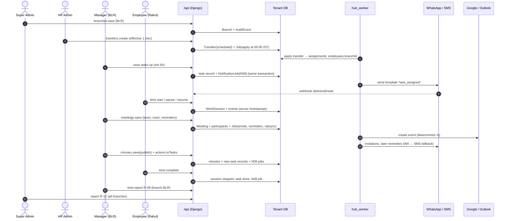
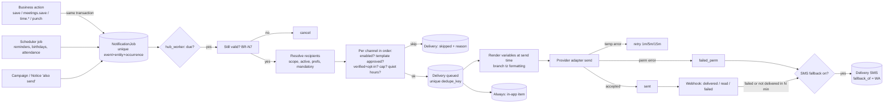
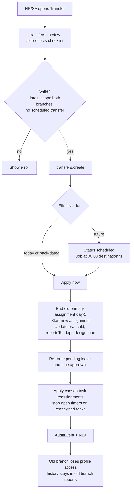
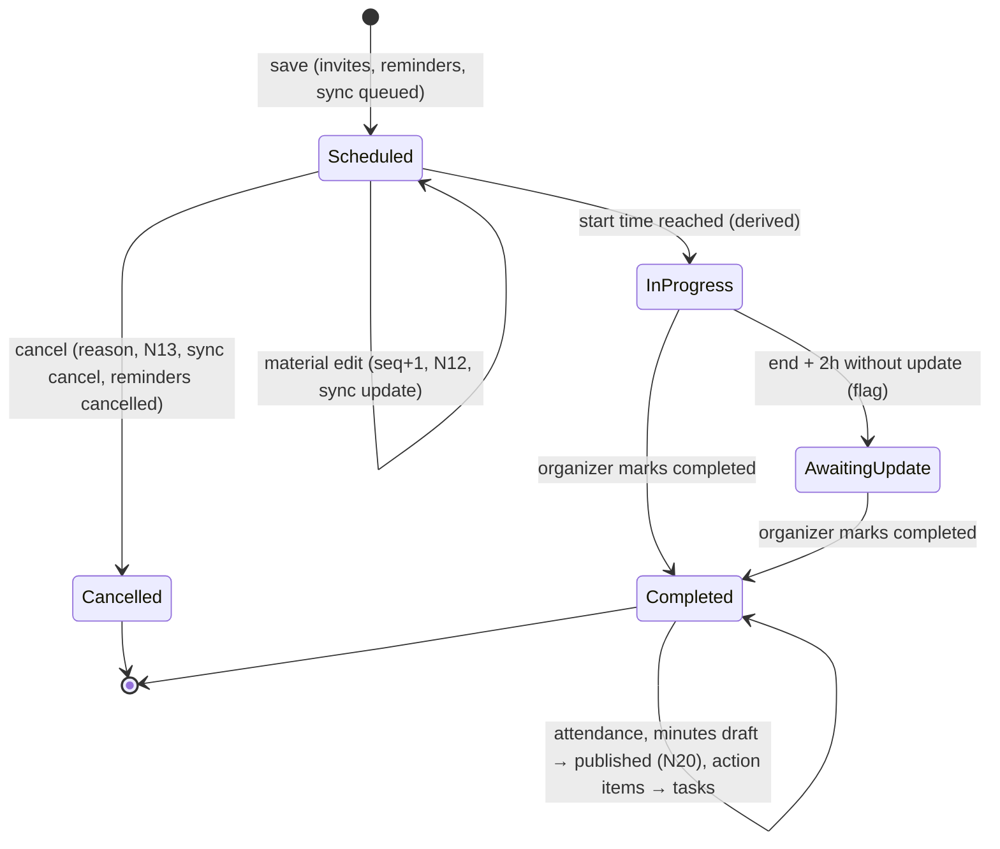
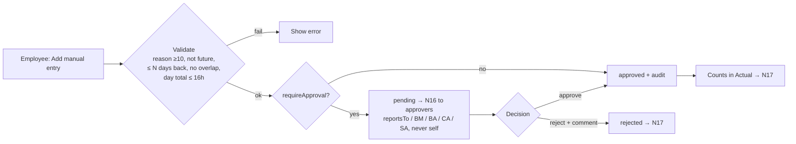
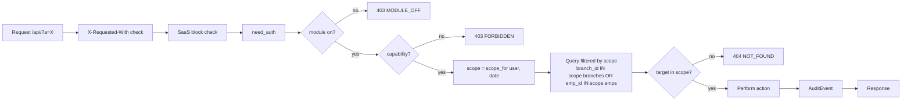

# 08 — End-to-End Workflows

## 1. Integrated workflow (Module 5): the 17 steps traced through the system

| # | Step | Actor | Screen | API | Data written | Notification | Shared foundation used |
|---|---|---|---|---|---|---|---|
| 1 | Create the Bangalore branch | SA | S-02 | `branches.save` | `Branch` | — | Audit, plan limit |
| 2 | Assign employees to BLR | HR | S-04 / bulk | `transfers.create` / `emp.assign` | `Transfer`, `EmployeeBranchAssignment`, `employees.branchId` | N19 at effective date | Scope, job runner |
| 3 | Create a task with a 5 h estimate | Manager / BM | S-22 | `save` (tasks op) | `tasks` record + `est`, `createdBy`, `branchId` | → step 4 | FR-PLT-12 |
| 4 | Employee gets a WhatsApp alert | System | — | job `notify.dispatch` | `NotificationJob`, `NotificationDelivery` | **N06** | Notification service, consent |
| 5 | Start the task timer | Employee | S-23/S-24 | `time.start` | `WorkSession` (running), `WorkSessionEvent` | — | Server clock |
| 6 | Pause and resume | Employee | S-24 | `time.pause` / `time.resume` | Events, running totals | — | — |
| 7 | Schedule a team meeting | Manager | S-17 | `meetings.conflicts`, `meetings.save` | `Meeting`, `MeetingParticipant` | → 10 | Scope, rooms, leave |
| 8 | Meeting appears in the widget | Participants | W1 | `meetings.widget` | — | — | Permission-aware widget |
| 9 | Synced to the connected calendar | System | — | job `calsync.push` | `CalendarEventLink` | Provider invite or `.ics` | Job runner, encrypted tokens |
| 10 | WhatsApp/SMS reminders | System | — | job `notify.dispatch` (scheduled) | Deliveries (+ SMS fallback) | **N10, N11** | Notification service |
| 11 | Meeting is held | Organizer | S-18 | `meetings.attendance`, `meetings.complete` | Participant attendance, status | — | — |
| 12 | Record minutes | Organizer | S-19 | `meetings.minutes.save` (publish) | `MeetingMinutes` | **N20** | — |
| 13 | Action items become tasks | Organizer | S-19 | `meetings.actions.toTasks` | `tasks` records (`src=meeting`), `MeetingActionItem.task_rid` | **N06** | Task module (same records) |
| 14 | Complete the original task | Employee | S-23 | `time.complete` | Session stopped, task `done` | **N08** | — |
| 15 | System calculates actual time | System | S-23 | `time.summary` | (computed) | N09 if over | Timer logic 04 §3 |
| 16 | Manager views productivity reports | Manager | S-28 | `time.report` R-01/R-08 | — | — | Scope, attribution |
| 17 | SA views consolidated branch reports | SA | S-28 | `time.report`, R-12 | — | — | Branch attribution BR-B7 |



## 2. Notification pipeline



## 3. Branch transfer



## 4. Meeting lifecycle



**Calendar sync per meeting save:** commit the meeting → queue `calsync.push(meeting, seq)` → the worker loads the organizer connection → if absent, queue an `.ics` e-mail per participant (same UID, SEQUENCE) → if present, upsert the provider event (deterministic id or `transactionId`), store the etag → on error, back off (04 §2.6). Because the `unique_key` is `calsync:{meeting}:{seq}`, a sequence is never pushed twice. An older sequence still in the queue is skipped when a newer one exists.

## 5. Task timer session

```mermaid
sequenceDiagram
    actor EM as Employee
    participant UI as Browser (timer bar)
    participant API as time.* actions
    participant DB as DB (WorkSession)
    participant W as hub_worker

    EM->>UI: ▶ Start work (task B)
    UI->>API: time.start {taskId:B, reqId, clientTs}
    API->>DB: running session exists? (A)
    alt A running and switch=false
        API-->>UI: 409 TIMER_ACTIVE {session A}
        UI->>EM: "Stop A and start B?"
        EM->>UI: Switch
        UI->>API: time.start {taskId:B, switch:true, reqId2}
        API->>DB: stop A at t, start B at t (one transaction)
    else none running
        API->>DB: insert session B (status running, started_at = server now)
    end
    API-->>UI: {session, now}
    UI->>UI: offset = now - Date.now(), render live time
    EM->>UI: ⏸ Pause (Client call)
    UI->>API: time.pause
    API->>DB: work += t - last; status paused; event
    Note over UI: Browser closed. Session continues on the server
    W->>DB: auto-stop check every minute
    W->>DB: cut-off reached → ended_at = cutoff, auto_stopped, needs_review
    W->>W: queue N18
```

## 6. Manual time entry and approval



## 7. Branch-scope enforcement (every request)


