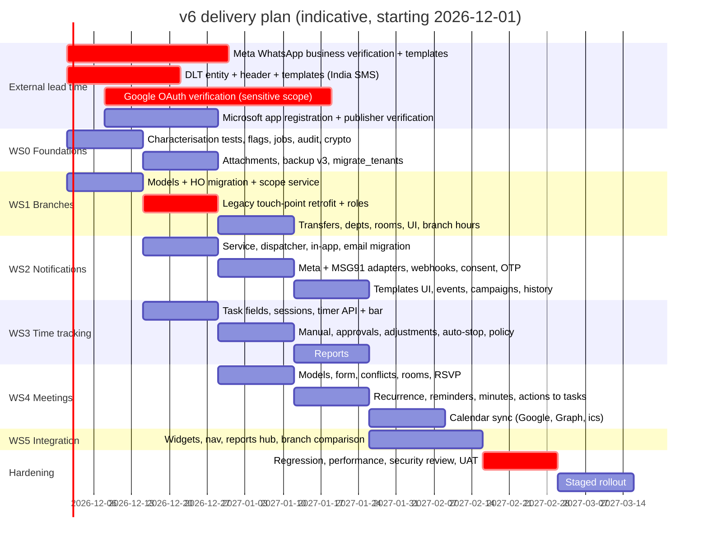

# 10 — Implementation Plan and Development Checklist

**Status:** Plan only. **No application code has been changed.** Implementation starts when this plan is approved.

## 1. Approach
- One integrated release, **v6**, delivered as **six workstreams**. They run in parallel once the WS0 foundations and the interfaces between them are agreed in sprint 1.
- Every v6 feature ships **behind a module switch, off by default**, so code can be merged and deployed continuously without changing what customers see. A pilot is turned on per tenant.
- The **contract-first interfaces** below let the streams develop in parallel without waiting for each other.

| Interface | Owner | Consumers | Available as a stub in |
|---|---|---|---|
| `scope_for(user, date) → Scope{branches, emp_ids, all}` and `in_scope(user, emp_id)` | WS1 | All | Sprint 1, week 1 (stub returns "all") |
| `notify.emit(event_key, entity_type, entity_id, occurrence_key, context, scheduled_for=None)` | WS2 | WS1, WS3, WS4 | Sprint 1, week 1 (stub writes the job, sends nothing) |
| `jobs.enqueue(kind, payload, run_at, unique_key)` + handler registry | WS0 | All | Sprint 1 |
| `audit.record(actor, action, entity, before, after)` | WS0 | All | Sprint 1 |
| `attachments.save/list/open` | WS0 | WS3, WS4 | Sprint 2 |
| `time.task_summary(task_ids) → {id: (actual, pending, state)}` | WS3 | WS4 (action items), WS5 | Sprint 2 |
| `calsync.push(meeting_id, seq)` | WS4b | WS4 | Sprint 3 |

## 2. Workstreams
| WS | Scope | Main files (new / changed) | Team |
|---|---|---|---|
| **WS0 Foundations** | Characterisation tests of today's permissions; `migrate_tenants`; job runner (`hub_worker`, `hub_tick`); outbox; encryption util; AuditEvent; attachments; module flags (`MODS`, `plans.py`); prefs merge; FR-PLT-12 preservation; `now` in responses; v6 dispatcher in `api()`; backup v3 | new `core/jobs.py`, `core/crypto.py`, `core/audit.py`, `core/files.py`, `core/v6.py`, `core/management/commands/*`, `core/tests/`; changed `core/views.py`, `core/models.py`, `saas/plans.py`, `saas/hooks.py`, `config/urls.py`, `saas/urls_tenant.py` | BE1 |
| **WS1 Branches & scope** | Models, HO migration, assignments, transfers, departments and designations, rooms, scope service, **retrofitting scope into every legacy touch point (§4)**, new roles, UI (S-01…S-06), branch filters, branch hours and holidays in attendance | new `core/branches.py`; changed `core/views.py`, `core/punch.py`, `index.html` | BE2, FE1 |
| **WS2 Notifications** | Providers (Meta, MSG91), templates, event config, dispatcher, retry and fallback, webhooks, consent and OTP, prefs, in-app inbox, e-mail channel migration, campaigns, Notice-board integration, history, usage, UI (S-07…S-13) | new `core/notify/` (`service.py`, `dispatch.py`, `providers/meta.py`, `providers/msg91.py`, `webhooks.py`, `consent.py`) | BE1 (from sprint 2), FE2 |
| **WS3 Time tracking** | Task field additions, sessions, state machine, timer API, timer bar, manual entries, approvals, adjustments, policy, auto-stop job, reports R-01…R-11, R-18, R-19 | new `core/worktime.py`; changed `index.html` (task form, card, detail) | BE2 (from sprint 2), FE1 |
| **WS4 Meetings (+ WS4b Calendar)** | Models, form and conditional logic, conflicts, recurrence, rooms booking, RSVP, minutes, action items → tasks, attendance, views, reports R-13…R-15. **WS4b:** OAuth (platform callback), Google and Graph adapters, `.ics` e-mail, push/poll RSVP, free/busy | new `core/meetings.py`, `core/calsync/` (`google.py`, `microsoft.py`, `ics.py`), `saas` OAuthState | BE3 (or BE1/BE2 from sprint 3), FE2 |
| **WS5 Dashboard, nav, reports hub** | Widgets W1–W7, customise, nav regrouping and in-page tabs, Reports hub, R-12/R-16/R-17/R-20, System health | `index.html`, `core/reports.py` | FE1/FE2 (sprints 4–5) |
| **QA** | Test plan, automation of TS-B06 (scope matrix) and TS-T01 (calculations), regression, performance | `core/tests/` | QA |

## 3. Sequencing (2-week sprints, ~6 sprints + hardening)

**Critical path:** WS1 legacy scope retrofit (highest risk) → WS5 branch comparison → hardening. External approvals run alongside, so **registration work starts on day 1** (owner: Product/customer success).

## 4. Affected modules and touch points (identified before any code change)

### 4.1 Backend: every place branch scope must be enforced
| File / function | Today | Change |
|---|---|---|
| `views.view_for` | `if rank >= 3: return db` (everything) | Rank-3 shortcut only for company-wide scope (SA/CA). Otherwise filter employees, tasks, reviews, leaves, attreqs, ratings, attendance, GEN collections with `eid` (documents, assets, payslips, checklists, rota) and `peers` by scope. Events filtered by `branchIds`. Add `branches`, `myScope`, `taskTime` |
| `views.team_of` | reportsTo scan | Unchanged for MG. A BM gets team ∪ branch employees |
| `views.can_set` | `admin → return new` in employees, tasks, reviews, attreqs, leaves, events | Add `in_scope` checks to every admin path. Preserve server-owned fields. Task create sets creator/branch. Assignee change → timer stop + N06 |
| `views.can_del` | admin → True | Add `in_scope`. Block task delete when sessions exist (EC-T04) |
| `views.op_att` | `rank >= 3` may mark anyone | Add `in_scope`. Write `b` |
| `views.op_rec` (`EVT` append) | queues e-mail | Calls `notify.emit` for leave/attreq events (and the new task events) |
| `views.flush_mail` | inline SMTP | Removed. Replaced by the e-mail channel (same content) |
| `views.handle: users / user_save / user_del / user_signout` | admins see users rank ≤ 2 | Filter by scope for HR/BA. New roles and branches. `active_supers` unchanged |
| `views.handle: audit` | full legacy log | Merge AuditEvent and filter |
| `views.handle: prefs` | overwrite | Merge |
| `views.handle: logout` | — | pauseOnLogout |
| `views.punch_actions: selfie` | rank ≥ 3 any | Scope check |
| `views.restore_db / write_backup / full_db` | Records only | Backup v3. `write_backup` stays per save for legacy data only |
| `views.api` | GET allow-list | `READ_ACTIONS` + v6 dispatcher + `now` |
| `views.RANK`, `prof()` | 4 roles | Add `hradmin: 3`, `branchadmin: 3`, `branchmgr: 2` |
| `punch.shift_for` | shift → company hours | shift → **branch hours** → company |
| `punch.record_punch` | — | Write `b`. Fire N03 on Late |
| `punch.check_in` | any site | Branch site restriction |
| `saas/plans.py`, `saas/hooks.py` | module lists | Add v6 modules per the packaging decision. Branch count limit |
| `saas/management/commands/saas_cron.py` | billing e-mails | Unchanged. New `hub_tick` is separate |
| `saas/urls_platform.py` | — | `/oauth/<provider>/callback` |
| `config/urls.py` + `saas/urls_tenant.py` | duplicated lists | Add `/hooks/...`, `/oauth/...` (single-company), `/files/<id>`, `/m/<token>` in **both** |
| `config/settings.py` | — | `INSTALLED_APPS` unchanged (all in `core`). New env: `HUB_ENC_KEYS`, `HUB_GOOGLE_*`, `HUB_MS_*`. Add `cryptography` (and `requests`, unless `urllib` is used) to `requirements.txt` |

### 4.2 Frontend (`core/app/index.html`): reuse, do not fork
| Area | Change |
|---|---|
| Constants | `COLS3` unchanged (v6 data is not in snapshot sync). Add to `MODS`, `VMOD`, `NAVG`, `navFor`, `allowed`, `NEWV`, `ICONS` |
| `RK`, `RL`, `RC` | New roles and labels |
| `empForm` / submit | Branch field (read-only after creation; changes go through Transfer). Department from the master |
| `taskForm` / submit / `taskCard` / `taskDetail` | New fields, time panel, timer buttons, at-risk badge, attachments |
| `vTasks` | In-page tabs |
| `vDashboard` / `row3Widgets` | Widget registry and customise |
| `notifs()` / `drawBell` | Merge the in-app inbox |
| `vCalendar` / `dayItems` | Meeting overlay. Holiday `branchIds` |
| `eventForm`, `noticeForm` | Branch audience; "Also send via" |
| `vSettings` / `settingsAccordion` | New sections |
| `vUsers` / `userForm` | Roles and branches |
| New views | `vBranches`, `vMeetings`, `vComms`, `vReports`, timer bar in `shell9` |
| API helper | A new `api6(action, body)` wrapper handling `code`, `now` offset and 401, reusing the `fetch` pattern |
| CSP | No change needed (inline script hash is recomputed automatically by `page_csp`). **Do not** add external scripts |

**Frontend size risk:** `index.html` grows past ~6,000 lines. Recommendation: keep one file this release (it matches the conventions and the CSP hash mechanism) but put v6 code in clearly delimited sections (`/* ---------- v6: meetings ---------- */`), following the existing layered pattern. Splitting into multiple static scripts (with `'self'` script-src) is a v6.1 refactor.

## 5. Migration and rollout plan
1. **Rehearsal:** copy every production DB → run migrations → run the TS-P01…P04 checks → visual diff of the main screens.
2. **Deploy code** with all v6 modules off. Run `migrate` / `migrate_tenants --backup`. Start the `hub_worker` systemd unit and the `hub_tick` cron (`* * * * *`).
3. **Smoke test** of existing functionality on production (TS-D05 subset).
4. **Pilot:** turn modules on for 2 tenants (one multi-branch). 2 weeks, with daily checks of System health.
5. **General availability:** modules available per plan. Meetings and time tracking on by default for new tenants only. Existing tenants opt in from Settings > Modules (existing policy).
6. **Rollback:** turn off the modules (instant). If needed, redeploy the previous code. The schema is additive, so no down-migration is required. Pre-migration DB copies are kept for 30 days.

**Runbook additions for README.txt:** worker service, cron, new env vars, provider webhook URLs, OAuth app set-up (platform callback URL), the `migrate_tenants` command, encryption key backup ("losing `HUB_ENC_KEYS` means reconnecting providers and calendars").

## 6. Risks and mitigations
| # | Risk | Likelihood | Impact | Mitigation |
|---|---|---|---|---|
| R1 | Scope retrofit misses a legacy path, so data leaks across branches | M | **Critical** | §4.1 checklist, the automated TS-B06 matrix in CI, code review by two people, security review |
| R2 | External approvals (Meta, DLT, Google) not ready | H | M | Start day 1. Release works with in-app/e-mail/`.ics`. Turn channels on per tenant later |
| R3 | SQLite write contention (timer bursts at shift start, dispatcher) | M | M | Short transactions, no `rev` bump or backup on v6 writes, WAL mode (`PRAGMA journal_mode=WAL` at connection), performance test TS-T19 |
| R4 | `index.html` complexity causes regressions | M | M | Delimited v6 sections, regression suite TS-D05, no edits to legacy functions beyond the listed touch points |
| R5 | Message cost disputes | M | M | Cap, preview cost, usage report |
| R6 | Employee pushback on timers | M | M | Information-only use, clear notice, no screenshots or activity monitoring, employee sees own data first |
| R7 | Parallel-timer policy conflicts with the DB unique constraint | L | L | Keep the partial unique index for the default. If any branch enables parallel timers, enforce in the service with a per-employee lock row (documented in 06 §3.3) |
| R8 | Calendar push needs public HTTPS (single-company installs on LAN) | M | L | Polling fallback (04 §2.5) |
| R9 | Legacy `load` growth for large tenants | M | M | NFR-P3 limits v6 additions. PostgreSQL and paged load planned for v6.1 |
| R10 | Loss of the encryption key | L | H | Documented key backup. Fail-safe: features degrade, app keeps working (EC-P01) |

## 7. Development implementation checklist

### 7.1 Before writing code
- [ ] Plan approved; open decisions OD-01…OD-08 in `00-README.md` resolved
- [ ] Meta Business verification, DLT registration, Google and Microsoft app registration started
- [ ] Characterisation tests written for `view_for`, `can_set`, `can_del`, `op_att`, `users`, `audit` for all 4 existing roles (they must pass before and after WS1)
- [ ] Interface stubs (§1) merged
- [ ] Test data set (09 §3) scripted as a management command (`seed_v6_demo`, never run in production)

### 7.2 Per feature (Definition of Done)
- [ ] Follows existing conventions: `/api/?a=` actions, `{ok, error}` + `code`, `ApiError`, `ID_RE` validation, `esc()` for every rendered string, existing UI components, light and dark
- [ ] Capability + scope checked on the server for every action (including exports and file downloads). Out-of-scope → 404
- [ ] Module flag respected (UI hidden + API `MODULE_OFF`)
- [ ] Inputs validated server-side (the UI validation is a convenience only)
- [ ] No external call inside the request transaction (outbox/jobs)
- [ ] AuditEvent for creates, updates, deletes and decisions
- [ ] Unit tests (calculations, rules) + API tests (happy path, validation, scope) + included in the TS-B06 matrix
- [ ] Mobile (360 px) and keyboard checked; `aria` labels
- [ ] No secrets in responses, logs or backups (test asserts)
- [ ] Migration is additive and idempotent; tested on a copy of a real DB
- [ ] README/runbook updated where operations change

### 7.3 Before release
- [ ] All TS-* in 09 passed; exit criteria met
- [ ] Performance test results recorded
- [ ] Security review complete
- [ ] Migration rehearsal on all tenant copies
- [ ] Release notes (customer-facing) and admin guide sections written: branches, transfers, notifications set-up, calendar connection, time tracking policy
- [ ] Support playbook: "message not received", "calendar not syncing", "timer wrong"

## 8. Testing documentation to produce during implementation
| Document | Content | Owner |
|---|---|---|
| `docs/release-v6/test-results.md` | Pass/fail per TS id, defects, evidence links | QA |
| `docs/release-v6/scope-matrix-results.md` | Automated TS-B06 output per build | QA/BE |
| `docs/release-v6/performance.md` | Method, data volume, p50/p95, findings | BE |
| `docs/release-v6/admin-guide.md` | Set-up guides for providers, OAuth, branches, policies | BA |
| `docs/release-v6/release-notes.md` | What changed for users | PM |
